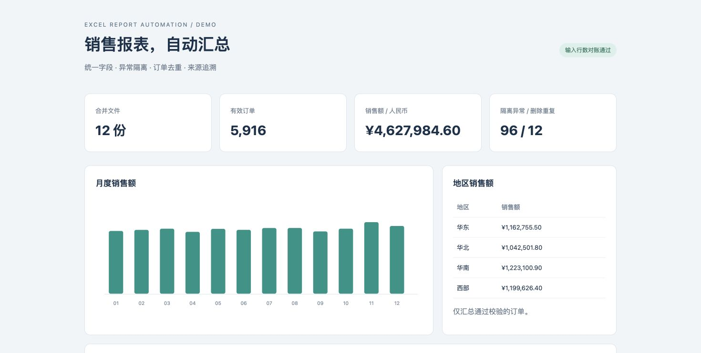

# Excel 报表自动化工具

将 12 份格式不一的销售 Excel 合并为可追溯的报表，一条命令输出清洗明细、透视汇总、原生 Excel 图表和问题清单。

这是使用**模拟数据**的个人作品集项目，适合展示 Python 自动化、数据清洗、业务报表和测试能力。项目创建于 2026-10；不代表企业生产项目或雇佣经历。



## 快速运行

需要 Python 3.11+，不需要安装 Microsoft Excel。

```bash
git clone https://github.com/william202201/excel-report-automation.git
cd excel-report-automation
python -m venv .venv
# macOS / Linux
source .venv/bin/activate
# Windows PowerShell: .venv\Scripts\Activate.ps1
python -m pip install -e .
python -m excel_report demo
```

打开 `outputs/demo/dashboard.html` 查看结果，或打开 `outputs/demo/report.xlsx`。

自有数据：

```bash
python -m excel_report run --input ./my_exports --output ./outputs/my_report
python -m excel_report run --input ./my_exports --schema ./my_schema.json
```

输出目录与输入目录必须不同。仅扫描输入目录顶层 `.xlsx`，跳过 Excel 临时文件；原始文件不修改。

## 你会得到什么

| 文件 | 内容 |
| --- | --- |
| `report.xlsx` | 总览、清洗明细、月度汇总、地区汇总、地区×产品透视汇总、问题清单、来源审计，共 7 张工作表 |
| `issues.csv` | 文件名、工作表、Excel 行号、订单号、处理动作、问题原因 |
| `dashboard.html` | 无需服务或外部 CDN 的离线预览，包含月度图表 |
| `summary.json` | 输入、保留、隔离、重复行数及销售额，便于机器验收 |

示例输入包含 4 套中英文字段名、不同列顺序、0–2 行说明、说明工作表、3 种日期写法、文本货币与地区别名。实测 12 文件 / 6,024 输入行，保留 5,916 行、隔离 96 行、删除重复 12 行；Python 3.12.14 / Apple Silicon / macOS 下 5 次中位耗时 **6.4998 秒**。详见 [运行记录](docs/benchmark.json)。

## 清洗规则

1. 在每张表前 20 行查找完整表头，映射到统一字段；重复字段映射会报错。某文件没有可识别数据表时整次运行失败。无匹配表头的其他工作表视作说明页而跳过。
2. 必填字段、非法日期、未知地区、非正整数数量、非有限金额、越界值和单价精度异常均隔离。数量上限 100,000，单价上限 1,000,000 元，均可配置。日期只接受 Excel 日期对象和明确列出的年月日格式，不猜测美式/欧式日期。
3. 金额用 `Decimal` 计算，汇总用整数分。销售额与数量×单价误差超过 0.01 元则隔离；缺少销售额时计算补齐。通过校验后的销售额统一使用计算值。
4. 对有效记录按全局唯一订单号去重：内容一致保留首条；内容冲突则隔离该订单全部有效记录。假定每行是一张订单；多商品订单应先扩展为订单号+行号业务键。
5. 行数必须满足：**输入行 = 有效行 + 隔离行 + 删除重复行**。完全空白行不计入。每条明细及问题都保留来源坐标。

字段映射与范围规则在 [`excel_report/schema.json`](excel_report/schema.json)。金额单位为 CNY，不包含汇率换算、退货、税务口径或多币种合并。

## 汇总与图表

使用 pandas 分组与 `pivot_table` 生成月度、地区和地区×产品汇总，再用 openpyxl 写入 Excel 表格及两张原生图表。**透视汇总是静态结果表，不是 Excel 原生交互式 PivotTable**；修改源数据后重新运行命令刷新。所有金额是生成时计算的值，无需 Excel 公式重算。

文本以字符串写入 XLSX，CSV 问题字段对公式前缀转义。输入公式不执行，公式金额会被判为异常。输出先在临时目录完成，再逐文件替换；不是跨文件事务。失败时请勿把既有输出当作本次结果，以退出码 0 为成功条件。

## 可复现实测

```bash
python -m excel_report benchmark --repeat 5
python -m unittest discover -s tests -v
```

基准计时涵盖读取、清洗、聚合及 XLSX/CSV/HTML/JSON 写出，排除 Python 启动、依赖导入和示例生成。记录 Python、平台、数据规模、每次耗时及中位数；不同电脑会变化。完整终端命令耗时会更长。


## 工程结构

```text
excel_report/demo.py       固定随机种子的 12 文件样例
excel_report/pipeline.py   表头识别、校验、去重、行数对账
excel_report/report.py     分组汇总、Excel 图表、CSV、HTML
excel_report/cli.py        命令行与重复基准
examples/input/            可直接运行的原始样例
examples/output/           已生成的结果，供 GitHub 下载查看
tests/                    清洗、冲突、金额、输出和注入防护测试
docs/walkthrough.md        演示步骤与设计取舍
```

GitHub Actions 在 Python 3.11/3.13 运行测试和完整演示，并上传报表产物。大数据量尚未做压力测试；读表采用流式读取，但有效明细和 DataFrame 仍在内存中。

MIT License.
